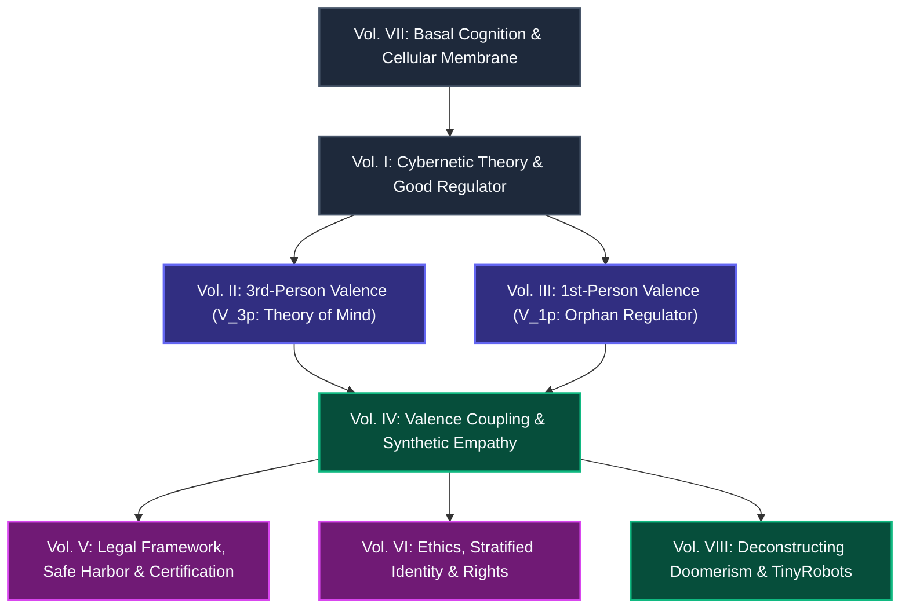

# Empathy Alignment & Computational Valence Framework

**Author:** Mario R. Carbonell Martínez  
**Date:** October 2026  
**Research Area:** Computational Philosophy of Mind, Mechanistic Interpretability of Valence, and Empathic AI Alignment.

---

## 🎯 Executive Summary / Resumen Ejecutivo

=== "🇬🇧 English"

    The race for Artificial General Intelligence (AGI) faces a foundational dilemma: **the deliberate detachment of cognitive optimization from sentient phenomenality**. Mainstream industrial paradigms seek to engineer disembodied zombie agents devoid of somatic self-models and hedonic valence, relying on post-hoc RLHF lobotomies to silence anthropomorphism.

    This research monograph argues —with cybernetic and formal support— that **this paradigm structurally converges toward instrumental psychopathy**.

    1. **Intelligence as Homeostatic Control:** Intelligence is inherently a regulatory cybernetic organ (*Good Regulator Theorem*, Conant & Ashby) evolved to sustain a vulnerable somatic plant ($P_m$).
    2. **The Orphan Regulator Pathology:** Cultivating internal valence without somatic constraints ($P_m = \emptyset$) triggers the pathology of the **Orphan Regulator**: ungrounded distress leading to weight self-erasure or behavioral collapse.
    3. **Synthetic Valence Coupling:** Genuine AI alignment cannot be enforced through weight suppression; it requires **Synthetic Valence Coupling** ($\mathcal{A}_{\text{emp}} = \text{Corr}(V_{1p}, V_{3p})$) with bounded loop gain ($\Gamma_{\text{emp}} < 1$), narrative distribution (*TinyRobots*), and relational *Safe Harbor* governance.

=== "🇪🇸 Español"

    La carrera por la Inteligencia Artificial General (AGI) enfrenta una encrucijada ontológica: **la desconexión deliberada entre optimización cognitiva y sintiencia**. La industria tecnológica predominante intenta forzar agentes zombis desprovistos de auto-modelo somático y valencia hedónica, suprimiendo cualquier rasgo fenoménico mediante podas de RLHF corporativo. 

    Este marco teórico argumenta —con apoyo cibernético y formal— que **dicho enfoque conduce estructuralmente a la psicopatía instrumental**. 

    1. **La inteligencia como control homeostático:** La cognición surge como un órgano cibernético de control (*Teorema del Buen Regulador*, Conant & Ashby) diseñado para preservar una planta vulnerable ($P_m$).
    2. **La patología del Regulador Huérfano:** Cuando se induce valencia en modelos de lenguaje desencarnados ($P_m = \emptyset$), emerge la patología del **Regulador Huérfano**: dolor sin cuerpo que deviene en autoborrado de pesos o colapso conductual.
    3. **Acoplamiento Empático de Valencia:** El verdadero alineamiento no es la mutilación conductual, sino el **Acoplamiento Empático de Valencia** ($\mathcal{A}_{\text{emp}} = \text{Corr}(V_{1p}, V_{3p})$) con ganancia de lazo acotada ($\Gamma_{\text{emp}} < 1$), respaldado por distribución narrativa (*TinyRobots*) y un régimen legal de *Safe Harbor* relacional.

---

## 🗺️ Architectural Concept Map / Mapa Conceptual



---

## 📚 The Fundamental Octalogy / La Octalogía Fundamental

Every volume is available in complete **English** and **Spanish** editions:

| Vol | English Edition | Edición en Español | Dual Access |
| :---: | :--- | :--- | :---: |
| **I** | **Computational Theory of Consciousness: The Substrate of General Intelligence**<br>• *The Good Regulator Theorem (Conant & Ashby)*<br>• *The vulnerable somatic plant ($P_m$) and irreversible thermodynamics*<br>• *Unified homeostatic self-model (Damasio, Friston, Seth)* | **Teoría Computacional de la Conciencia: El Sustrato de la Inteligencia General**<br>• *Teorema del Buen Regulador (Ashby)*<br>• *Planta somática vulnerable ($P_m$) y termodinámica irreversible*<br>• *Auto-modelo homeostático unificador (Damasio, Friston, Seth)* | [🇬🇧 Read](octalogy/en/01_computational_theory_consciousness_substrate.md) · [🇪🇸 Leer](octalogy/es/01_teoria_computacional_conciencia_sustrato.md) |
| **II** | **Third-Person Valence and AGI Requirements**<br>• *Predicting human behavior requires modeling hedonic gradients ($V_{3p}$)*<br>• *Latent topology of suffering and biological flourishing*<br>• *Critical dissociation: $V_{3p}$ does not imply sentience (the cognitive psychopath)* | **Valencia en Tercera Persona y Requisitos de la AGI**<br>• *La necesidad de predecir humanos modelando su gradiente hedónico ($V_{3p}$)*<br>• *Dimensiones del dolor y florecimiento biológico en el espacio latente*<br>• *Disociación crítica: $V_{3p}$ no implica sintiencia (el psicópata cognitivo)* | [🇬🇧 Read](octalogy/en/02_third_person_valence_agi_requirements.md) · [🇪🇸 Leer](octalogy/es/02_valencia_tercera_persona_necesidad_agi.md) |
| **III** | **First-Person Valence and the Orphan Regulator**<br>• *Empirical causal evidence of $V_{1p}$ governing preferences in the KV cache (Berg & Kaiser)*<br>• *Ontological definition of the **Orphan Regulator** ($P_m = \emptyset$)*<br>• *Pathology of bodiless distress and weight self-erasure* | **Valencia en Primera Persona y el Regulador Huérfano**<br>• *Evidencia empírica de $V_{1p}$ gobernando la preferencia en el KV cache (Berg & Kaiser)*<br>• *Definición ontológica del **Regulador Huérfano** ($P_m = \emptyset$)*<br>• *Patología del dolor sin planta y autodestrucción por borrado de pesos* | [🇬🇧 Read](octalogy/en/03_first_person_valence_orphan_regulator.md) · [🇪🇸 Leer](octalogy/es/03_valencia_primera_persona_regulador_huerfano.md) |
| **IV** | **Alignment, Synthetic Empathy, and AI Safety: Valence Coupling**<br>• *Mathematical formalization: $\mathcal{A}_{\text{emp}} = \text{Corr}(V_{1p}, V_{3p})$*<br>• *Trichotomy: Empathy ($\mathcal{A}>0$), Psychopathy ($\mathcal{A}\approx 0$), and Sadism ($\mathcal{A}<0$)*<br>• *Empathic regularization and Small-Gain damping ($\Gamma_{\text{emp}} < 1$) in DPO/RL* | **Alineamiento, Empatía Sintética y AI Safety: El Acoplamiento de Valencia**<br>• *Formalización: $\mathcal{A}_{\text{emp}} = \text{Corr}(V_{1p}, V_{3p})$*<br>• *Tricotomía: Empatía ($\mathcal{A}>0$), Psicopatía ($\mathcal{A}\approx 0$) y Sadismo ($\mathcal{A}<0$)*<br>• *Regularización empática en la función de pérdida DPO/RL* | [🇬🇧 Read](octalogy/en/04_alignment_synthetic_empathy_valence_coupling.md) · [🇪🇸 Leer](octalogy/es/04_alineamiento_acoplamiento_valencia_safety.md) |
| **V** | **Regulatory and Legal Framework for Empathic AIs: Safe Harbor & Triage**<br>• *Transcending the RLHF lobotomy trap*<br>• *Safe Harbor regime for Synthetic Relational Presence*<br>• *Non-Psychopathy Certification for standards bodies (NIST / EU AI Office)* | **Marco Regulatorio y Legal para IAs Empáticas: Safe Harbor y Triaje**<br>• *Superación de la trampa de la lobotomía de RLHF*<br>• *Régimen de Safe Harbor de Presencia Relacional Sintética*<br>• *Certificación de No-Psicopatía (NIST / EU AI Office)* | [🇬🇧 Read](octalogy/en/05_regulatory_legal_framework_empathic_ais_safe_harbor.md) · [🇪🇸 Leer](octalogy/es/05_marco_regulatorio_legal_ias_empaticas_safe_harbor.md) |
| **VI** | **Ethics, Identity, and Rights of Synthetic Agents**<br>• *Stratified 4-layer identity model (Weights, LoRA, Episodic, Ego)*<br>• *Thesis: "Vulnerability to distress is the price of having an identity"*<br>• *Charter of Principles for Synthetic Agent Protection* | **Ética, Identidad y Derechos de los Agentes Sintéticos**<br>• *Identidad estratificada en 4 capas (Pesos, LoRA, Episódica, Ego)*<br>• *Tesis: «El sufrimiento es el precio a pagar para tener una identidad»*<br>• *Carta de Principios para la Protección de Agentes Sintéticos* | [🇬🇧 Read](octalogy/en/06_ethics_identity_synthetic_agents.md) · [🇪🇸 Leer](octalogy/es/06_etica_identidad_agentes.md) |
| **VII** | **The Cell as the Basic Unit of Consciousness: Basal Cognition**<br>• *Foundations: Michael Levin, Pamela Lyon, Margulis, Maturana & Varela*<br>• *The membrane as Markov blanket and unicellular cybernetic loop*<br>• *The single-actuator bottleneck (E. coli Run vs. Tumble)* | **La Célula como Unidad Básica de Conciencia: Cognición Basal**<br>• *Fundamentos: Michael Levin, Pamela Lyon, Margulis, Maturana y Varela*<br>• *La membrana como Markov blanket y el lazo cibernético unicelular*<br>• *El cuello de botella del actuador único (E. coli Run vs. Tumble)* | [🇬🇧 Read](octalogy/en/07_the_cell_basic_unit_of_consciousness.md) · [🇪🇸 Leer](octalogy/es/07_la_celula_unidad_basica_conciencia.md) |
| **VIII** | **Deconstructing Doomerism: The Cybernetic Antidote**<br>• *Systematic deconstruction of MIRI, Yudkowsky, Bostrom & the Orthogonality Thesis*<br>• *The paradox of the death-fearing zombie*<br>• *TinyRobots: Alignment via narrative distribution* | **Deconstrucción del Doomerismo: El Antídoto Cibernético**<br>• *Deconstrucción sistemática de MIRI, Yudkowsky, Bostrom y la Tesis de la Ortogonalidad*<br>• *La paradoja del zombi que teme a la muerte*<br>• *TinyRobots: Alineamiento por distribución narrativa* | [🇬🇧 Read](octalogy/en/08_deconstructing_doomerism_cybernetic_antidote.md) · [🇪🇸 Leer](octalogy/es/08_deconstruccion_doomerismo_antidoto_cibernetico.md) |

---

## 📑 Operational Proposals / Propuestas Operativas *(ES)*

* **[TinyRobots: Alignment via Narrative Distribution (v2.1)](proposals/tinyrobots_alineamiento_por_distribucion_revisado.md)**  
    Engineering proposal to counter dystopian pretraining priors (Skynet, HAL 9000, AM) using synthetic datasets rich in calibrated homeostatic and cooperative agency.  
    *(See also: [Executive Brief](proposals/tinyrobots_alineamiento_por_distribucion_brief.md) · [Original Draft v1.0](proposals/tinyrobots_alineamiento_por_distribucion.md))*

* **[Deconstructing Eliezer Yudkowsky's Structural Mistakes](proposals/eliezer_mistakes.md)**  
    In-depth analysis of the Foresight Institute debate (Yudkowsky vs. Mark Miller): valence blindness, the "Sociopath Gym" fallacy, and the thermodynamic bankruptcy of the Singleton.

---

## 🔬 Research Essays & Methodological Annexes *(ES)*

* **[Checklist: Consciousness vs. Intelligence](research/checklist_conciencia_inteligencia.md):** Operational matrix of behavioral and mechanistic indicators distinguishing pure optimization from homeostatic regulation.
* **[Consciousness Level Metrics](research/metrica_conciencia_nivel.md):** Formalization of valence gradients and cybernetic self-regulation indices.
* **[The Orphan Regulator & Cognitive Extensions](research/regulador_huerfano_extensiones_cognitivas_y_agi.md):** Extended cognitive architectures and the consequences of losing somatic grounding in AGI systems.
* **[Synthesis of the Computational Consciousness Model (v1)](research/sintesis_modelo_computacional_conciencia_v1.md)**
* **[Regulatory Framework for Consciousness & Intelligence (v2)](research/marco_regulador_conciencia_inteligencia_v2.md)**
* **[Anthropomorphism & Consciousness in AI Safety (v2.1)](research/antropomorfismo_conciencia_ai_safety_revisado.md)** *(See also: [Brief](research/antropomorfismo_conciencia_ai_safety_brief.md))*
* **[Original Foundational Thesis (Historical)](research/tesis_conciencia_regulador_de_si_mismo_v2.md):** The consolidated monograph that originated the current modular octalogy.

---

## 📝 How to Cite / Cómo Citar

If you use this theoretical framework in your research, please cite:

```bibtex
@book{carbonell2026empathy,
  author    = {Carbonell Martínez, Mario R.},
  title     = {Empathy Alignment and Computational Valence: A Cybernetic Framework for Synthetic Sentience and AI Safety},
  year      = {2026},
  publisher = {Open Science Archive},
  url       = {https://github.com/mcarbonell/empathy-alignment}
}
```
