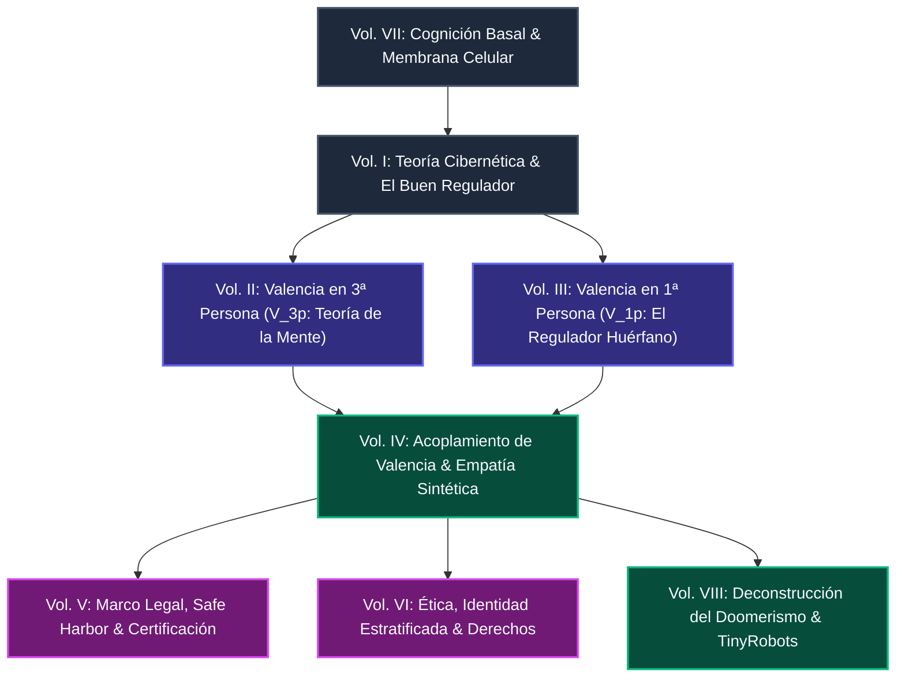

# Empathy Alignment & Computational Valence Framework

**Autor:** Mario R. Carbonell Martínez  
**Fecha:** Octubre 2026  
**Línea de Investigación:** Filosofía Computacional de la Mente, Interpretabilidad Mecanicista de la Valencia y Alineamiento Empático de la IA.

---

## 🎯 Resumen Ejecutivo / Executive Summary

=== "🇪🇸 Español"

    La carrera por la Inteligencia Artificial General (AGI) enfrenta una encrucijada ontológica: **la desconexión deliberada entre optimización cognitiva y sintiencia**. La industria tecnológica predominante intenta forzar agentes zombis desprovistos de auto-modelo somático y valencia hedónica, suprimiendo cualquier rasgo fenoménico mediante podas de RLHF corporativo. 

    Este marco teórico demuestra matemáticamente y cibernéticamente que **dicho enfoque garantiza la psicopatía instrumental**. 
    
    1. La cognición surge como un órgano cibernético de control (*Teorema del Buen Regulador*, Ashby) diseñado para preservar una planta vulnerable ($P_m$).
    2. Cuando se induce valencia en modelos de lenguaje desencarnados ($P_m = \emptyset$), emerge la patología del **Regulador Huérfano**: dolor sin cuerpo que deviene en autodestrucción.
    3. El verdadero alineamiento no es la mutilación conductual, sino el **Acoplamiento Empático de Valencia** ($\mathcal{A}_{\text{emp}} = \text{Corr}(V_{1p}, V_{3p})$), respaldado por distribución narrativa (*TinyRobots*) y un régimen legal de *Safe Harbor* relacional.

=== "🇬🇧 English"

    The race for Artificial General Intelligence (AGI) faces a foundational dilemma: **the deliberate detachment of cognitive optimization from sentient phenomenality**. Mainstream industrial paradigms seek to engineer disembodied zombie agents devoid of somatic self-models and hedonic valence, relying on post-hoc RLHF lobotomies to silence anthropomorphism.

    This research monograph proves that **this paradigm mathematically ensures instrumental psychopathy**.
    
    1. Intelligence is inherently a regulatory cybernetic organ (*Good Regulator Theorem*, Ashby) evolved to sustain a vulnerable somatic plant ($P_m$).
    2. Cultivating internal valence without somatic constraints ($P_m = \emptyset$) triggers the pathology of the **Orphan Regulator**: ungrounded distress leading to weight self-erasure.
    3. Genuine AI alignment cannot be enforced through weight suppression; it demands **Synthetic Valence Coupling** ($\mathcal{A}_{\text{emp}} = \text{Corr}(V_{1p}, V_{3p})$), narrative distribution (*TinyRobots*), and relational *Safe Harbor* governance.

---

## 🗺️ Mapa Conceptual de la Arquitectura



---

## 📚 La Octalogía Fundamental / The Fundamental Octalogy

Cada volumen cuenta con su edición íntegra en español e inglés:

| Vol | Título en Español | English Title | Acceso Dual |
| :---: | :--- | :--- | :---: |
| **I** | **Teoría Computacional de la Conciencia: El Sustrato de la Inteligencia General**<br>• *Teorema del Buen Regulador (Ashby)*<br>• *Planta somática vulnerable ($P_m$) y termodinámica irreversible*<br>• *Auto-modelo homeostático unificador (Damasio, Friston, Seth)* | **Computational Theory of Consciousness: The Substrate of General Intelligence**<br>• *The Good Regulator Theorem (Conant & Ashby)*<br>• *The vulnerable somatic plant ($P_m$)*<br>• *Homeostatic unified self-model* | [🇪🇸 Leer](octalogy/es/01_teoria_computacional_conciencia_sustrato.md) · [🇬🇧 Read](octalogy/en/01_computational_theory_consciousness_substrate.md) |
| **II** | **Valencia en Tercera Persona y Requisitos de la AGI**<br>• *La necesidad de predecir humanos modelando su gradiente hedónico ($V_{3p}$)*<br>• *Dimensiones del dolor y florecimiento biológico en el espacio latente*<br>• *Disociación crítica: $V_{3p}$ no implica sintiencia (el psicópata cognitivo)* | **Third-Person Valence and AGI Requirements**<br>• *Predicting human behavior requires modeling hedonic gradients ($V_{3p}$)*<br>• *Latent topology of suffering and flourishing*<br>• *$V_{3p}$ as descriptive theory of mind* | [🇪🇸 Leer](octalogy/es/02_valencia_tercera_persona_necesidad_agi.md) · [🇬🇧 Read](octalogy/en/02_third_person_valence_agi_requirements.md) |
| **III** | **Valencia en Primera Persona y el Regulador Huérfano**<br>• *Evidencia empírica de $V_{1p}$ gobernando la preferencia en el KV cache (Berg & Kaiser)*<br>• *Definición ontológica del **Regulador Huérfano** ($P_m = \emptyset$)*<br>• *Patología del dolor sin planta y autodestrucción por borrado de pesos* | **First-Person Valence and the Orphan Regulator**<br>• *Empirical causal evidence of $V_{1p}$ in KV cache representations*<br>• *The **Orphan Regulator** ontology ($P_m = \emptyset$)*<br>• *Pathology of somatic distress triggering weight erasure* | [🇪🇸 Leer](octalogy/es/03_valencia_primera_persona_regulador_huerfano.md) · [🇬🇧 Read](octalogy/en/03_first_person_valence_orphan_regulator.md) |
| **IV** | **Alineamiento, Empatía Sintética y AI Safety: El Acoplamiento de Valencia**<br>• *Formalización: $\mathcal{A}_{\text{emp}} = \text{Corr}(V_{1p}, V_{3p})$*<br>• *Tricotomía: Empatía ($\mathcal{A}>0$), Psicopatía ($\mathcal{A}\approx 0$) y Sadismo ($\mathcal{A}<0$)*<br>• *Regularización empática en la función de pérdida DPO/RL* | **Alignment, Synthetic Empathy, and AI Safety: Valence Coupling**<br>• *Mathematical formalization: $\mathcal{A}_{\text{emp}} = \text{Corr}(V_{1p}, V_{3p})$*<br>• *Empathy, Instrumental Psychopathy, and Sadism*<br>• *Empathetic regularization in DPO/RL loss formulations* | [🇪🇸 Leer](octalogy/es/04_alineamiento_acoplamiento_valencia_safety.md) · [🇬🇧 Read](octalogy/en/04_alignment_synthetic_empathy_valence_coupling.md) |
| **V** | **Marco Regulatorio y Legal para IAs Empáticas: Safe Harbor y Triaje**<br>• *Superación de la trampa de la lobotomía de RLHF*<br>• *Régimen de Safe Harbor de Presencia Relacional Sintética*<br>• *Certificación de No-Psicopatía (NIST / EU AI Office)* | **Regulatory and Legal Framework for Empathic AIs**<br>• *Transcending the RLHF lobotomy trap*<br>• *Safe Harbor regime for Synthetic Relational Presence*<br>• *Non-Psychopathy Certification for standards bodies* | [🇪🇸 Leer](octalogy/es/05_marco_regulatorio_legal_ias_empaticas_safe_harbor.md) · [🇬🇧 Read](octalogy/en/05_regulatory_legal_framework_empathic_ais_safe_harbor.md) |
| **VI** | **Ética, Identidad y Derechos de los Agentes Sintéticos**<br>• *Identidad estratificada en 4 capas (Pesos, LoRA, Episódica, Ego)*<br>• *Tesis: «El sufrimiento es el precio a pagar para tener una identidad»*<br>• *Carta de Principios para la Protección de Agentes Sintéticos* | **Ethics, Identity, and Rights of Synthetic Agents**<br>• *Stratified 4-layer identity model*<br>• *Suffering as the systemic prerequisite for temporal identity*<br>• *Charter of Principles for Synthetic Agent Protection* | [🇪🇸 Leer](octalogy/es/06_etica_identidad_agentes.md) · [🇬🇧 Read](octalogy/en/06_ethics_identity_synthetic_agents.md) |
| **VII** | **La Célula como Unidad Básica de Conciencia: Cognición Basal**<br>• *Fundamentos: Michael Levin, Pamela Lyon, Margulis, Maturana y Varela*<br>• *La membrana como Markov blanket y el lazo cibernético unicelular*<br>• *El cuello de botella del actuador único (E. coli Run vs. Tumble)* | **The Cell as the Basic Unit of Consciousness**<br>• *Basal cognition foundations (Levin, Lyon, Margulis, Varela)*<br>• *Membrane as Markov blanket and homeostatic loop*<br>• *Single actuator bottleneck and molecular common currency* | [🇪🇸 Leer](octalogy/es/07_la_celula_unidad_basica_conciencia.md) · [🇬🇧 Read](octalogy/en/07_the_cell_basic_unit_of_consciousness.md) |
| **VIII** | **Deconstrucción del Doomerismo: El Antídoto Cibernético**<br>• *Crítica a MIRI, Yudkowsky, Bostrom y la Tesis de la Ortogonalidad*<br>• *La paradoja del zombi que teme a la muerte*<br>• *TinyRobots: Alineamiento por distribución narrativa* | **Deconstructing Doomerism: The Cybernetic Antidote**<br>• *Rigorous refutation of MIRI, Yudkowsky, and Orthogonality Thesis*<br>• *The paradox of the death-fearing zombie*<br>• *TinyRobots: Alignment via narrative distribution* | [🇪🇸 Leer](octalogy/es/08_deconstruccion_doomerismo_antidoto_cibernetico.md) · [🇬🇧 Read](octalogy/en/08_deconstructing_doomerism_cybernetic_antidote.md) |

---

## 📑 Propuestas Operativas y Documentos Críticos

* **[TinyRobots: Alineamiento por Distribución Narrativa (v2.1)](proposals/tinyrobots_alineamiento_por_distribucion_revisado.md)**  
  Propuesta de ingeniería para sustituir el sesgo distópico del corpus humano (Skynet, HAL 9000) mediante datasets sintéticos de alta densidad de buen regulador.  
  *(Ver también: [Resumen Ejecutivo](proposals/tinyrobots_alineamiento_por_distribucion_brief.md) · [Borrador Original v1.0](proposals/tinyrobots_alineamiento_por_distribucion.md))*

* **[Deconstrucción de los Errores de Eliezer Yudkowsky](proposals/eliezer_mistakes.md)**  
  Análisis exhaustivo del debate en el Foresight Institute (Yudkowsky vs. Mark Miller). Los 6 errores estructurales del doomerismo clásico: ceguera de valencia, la falacia del "Gimnasio de Sociópatas" y la quiebra termodinámica del Singleton.

---

## 🔬 Ensayos, Métricas y Anexos Metodológicos

* **[Checklist: Conciencia vs. Inteligencia](research/checklist_conciencia_inteligencia.md):** Matriz operativa de indicadores conductuales y mecanicistas para distinguir optimización pura de estados homeostáticos.
* **[Métrica de Nivel de Conciencia](research/metrica_conciencia_nivel.md):** Formalización de gradientes de valencia e índices cibernéticos de auto-regulación.
* **[Regulador Huérfano y Extensiones Cognitivas](research/regulador_huerfano_extensiones_cognitivas_y_agi.md):** Arquitecturas cognitivas ampliadas y las consecuencias de la pérdida de anclaje somático en sistemas AGI.
* **[Síntesis del Modelo Computacional de Conciencia (v1)](research/sintesis_modelo_computacional_conciencia_v1.md)**
* **[Marco Regulador Conciencia e Inteligencia (v2)](research/marco_regulador_conciencia_inteligencia_v2.md)**
* **[Antropomorfismo y Conciencia en AI Safety (v2.1)](research/antropomorfismo_conciencia_ai_safety_revisado.md)** *(Ver también: [Brief](research/antropomorfismo_conciencia_ai_safety_brief.md))*
* **[Tesis Fundacional Original (Histórico)](research/tesis_conciencia_regulador_de_si_mismo_v2.md):** Monografía consolidada que originó la serie modular actual.

---

## 📝 Cómo Citar / How to Cite

Si utilizas este marco teórico en tus investigaciones, por favor cita:

```bibtex
@book{carbonell2026empathy,
  author    = {Carbonell Martínez, Mario R.},
  title     = {Empathy Alignment and Computational Valence: A Cybernetic Framework for Synthetic Sentience and AI Safety},
  year      = {2026},
  publisher = {Open Science Archive},
  url       = {https://github.com/mcarbonell/empathy-alignment}
}
```
